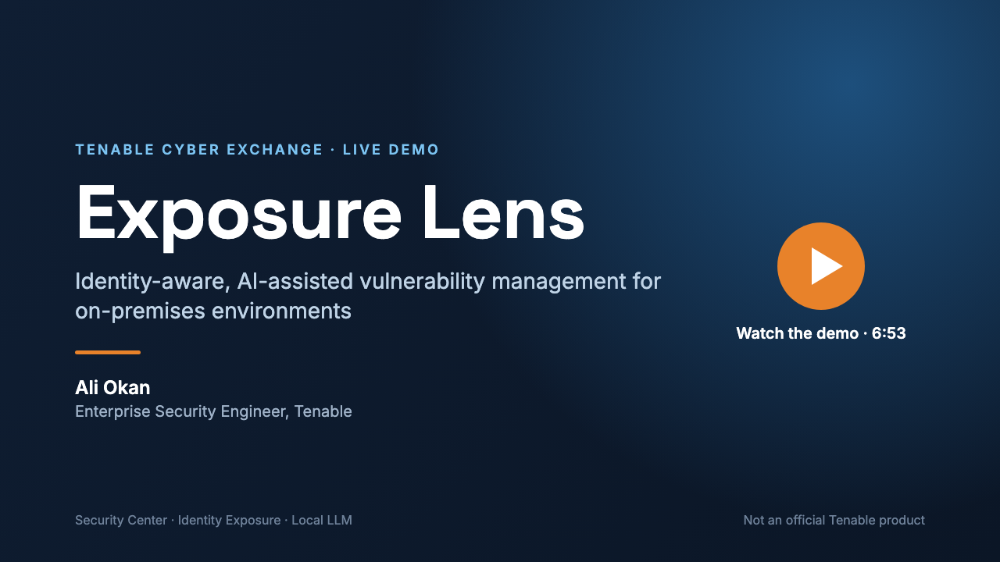

# Exposure Lens

Identity-aware, AI-assisted vulnerability management for on-premises environments.

Exposure Lens pulls data from Tenable Security Center and Tenable Identity Exposure into PostgreSQL and shows the two side by side in a web UI. It links vulnerabilities to the identities that can reach the affected hosts: who logs on where, who is a local administrator, which service accounts run on critical systems. **Agent Tenable**, a chat assistant backed by a local LLM (Ollama), answers questions about that data, so nothing leaves your environment.

It is built for teams that run Security Center and Identity Exposure on-premises, for example because of regulation or data residency, and cannot use the cloud features of Tenable One.

> Exposure Lens is a Tenable Cyber Exchange community project. It is **not an official Tenable product** and is not supported by Tenable.

Built together by **Ali Okan Yüksel** and **Taher Karaki**. See [Authors](#authors).

## Demo

[](docs/demo/exposure-lens-demo.mp4)

A 7-minute walkthrough of the UI ([video](docs/demo/exposure-lens-demo.mp4), [English subtitles](docs/demo/exposure-lens-demo.en.srt)):

| Time | Section |
| --- | --- |
| 0:00 | Why Exposure Lens: Tenable One runs in the cloud; on-premises customers need identity context too |
| 1:22 | The dashboard: vulnerabilities, risky identities and the hosts they reach; the "i" tips on each widget |
| 2:11 | Integrations: Security Center (API URL, keys, vulnerability filters) |
| 2:43 | Integrations: Identity Exposure (API URL, sync interval) |
| 3:07 | The local LLM (Ollama, `gemma4:31b`); no data leaves the environment |
| 3:36 | Agent Tenable: "investigate this user" with tools, skills and sub-agents |
| 4:41 | Asset card: connected systems, vulnerabilities grouped by host or CVE, risk details |
| 5:25 | Correlation evidence: why a user is related to a finding; the user's groups |
| 5:47 | Explore: Local Users, Software Inventory, Browser Extensions |
| 6:28 | Summary |

## What you get

- **Dashboard:** findings by severity, risky identities, users reaching critical hosts, hosts under Tier 0 accounts and service accounts on critical hosts. Every widget explains how it is calculated.
- **Risk:** for each host, its findings, Asset Criticality Rating and AD tier, joined to every identity that can reach it and the evidence for that access.
- **Explore:** Assets, Hosts, AD Objects, Findings, Software Inventory, Local Users and Browser Extensions, with filters and detail panels.
- **Asset Details:** one page per identity or host with connected systems, vulnerabilities, a risk score with its factors, and the correlation evidence (the plugin output line, how the name was matched to AD, and the group path).
- **Agent Tenable:** answers in Turkish or English, shows the data it used as tables and links every value to the screen that shows it.
- **Data:** everything is in PostgreSQL (see [Database](#database)), so you can also query it directly.

## Services

| Service | What it does |
| --- | --- |
| `postgres` | PostgreSQL 17, the data store. |
| `migrate` | Applies the Alembic revisions in `db/` and exits. The other services wait for it. |
| `tie` | [TIE connector](connectors/tie/README.md): serves Identity Exposure data as JSON over HTTP. |
| `tie_postgres` | [TIE to PostgreSQL connector](connectors/tie_postgres/README.md): mirrors AD objects from `tie` into PostgreSQL. |
| `sc` | [Security Center connector](connectors/sc/README.md): pulls cumulative vulnerabilities and plugin output into PostgreSQL. |
| `ctem` | [CTEM worker](connectors/ctem/README.md): parses plugin output, matches identities to AD and builds the Risk data. |
| `php`, `web` | The web UI in `wwwroot/` (php-fpm behind nginx), on port 8085 of every interface (`http://<host>:8085`). Includes **Agent Tenable**, the chat assistant (see below). |

Application code is bind-mounted into the containers. The images hold only runtimes and libraries, so a code change needs no rebuild. A Python connector reads its code at start; restart it after a change (`docker compose restart sc`).

## Requirements

- Docker Engine 24+ with Compose v2 (Docker Desktop on macOS works). No local PHP, Python or PostgreSQL is needed; everything runs in containers.
- Network access from the Docker host to: Security Center (HTTPS), Identity Exposure (HTTPS) and, for Agent Tenable, an Ollama server with a tool-capable model (`gemma4:31b` tested). The Ollama server can be another machine on the LAN.
- About 2 GB of RAM for PostgreSQL (`shared_buffers=512MB`) plus the workers; the LLM runs on its own server.
- Docker networks must not overlap the LAN. If a container cannot reach a 192.168.x address, check `docker network ls` and `docker network inspect <name>` for a bridge whose subnet covers it; this project pins itself to `10.98.0.0/24`.

## First run

```sh
git clone <this repository> exposure-lens && cd exposure-lens
cp .env.example .env                      # set pg_password; tie_host and tie_apikey for Identity Exposure
mkdir -p secrets data/ai-packs logs
openssl rand -hex 32 > secrets/tie_connector_token
openssl rand -hex 32 > secrets/app_secret_key
chmod 600 secrets/*
docker compose up -d --build              # builds the images, runs the Alembic migrations, starts everything
docker compose ps                         # all services "Up", migrate "Exited (0)"
```

Open `http://<host>:8085` (change `web_port` in `.env` to use another port), then:

1. **Settings > Security Center:** enter the URL and API keys, run **Test connection**, add a pool, add a query to it, and press **Sync now**. The `sc` connector picks the job up within 30 seconds.
2. **Settings > Identity Exposure:** run **Test connection**, then **Sync now**.
3. **Settings > CTEM Pipeline:** run **plugin_collect** once (it needs SC credentials from step 1); `extract` and `correlate` follow by themselves. Risk, Local Users, Software and the dashboard read models fill after `correlate` finishes.
4. **Settings > Agent Tenable:** enter the Ollama URL (`http://host.docker.internal:11434` for Ollama on the Docker host, which is the default, or `http://<ollama-host>:11434`), press **Test and list models**, pick a model that lists `tools` among its capabilities, save. The robot icon at the top right opens the chat.

`secrets/app_secret_key` encrypts the Security Center keys and the TIE token stored in PostgreSQL. If you replace it, enter those values again in Settings.

The UI has no login yet and is published on all interfaces (`0.0.0.0`), so anyone who can reach the host on the network can use it. Restrict the port with a firewall, or change the binding in `docker-compose.yml` back to `127.0.0.1`. PostgreSQL (5432) and the TIE gateway (8080) stay on `127.0.0.1`.

### Day-to-day

```sh
docker compose up -d                      # start after a reboot (migrations run again, harmlessly)
docker compose restart sc ctem            # a Python connector reads its code at start
docker compose build php && docker compose up -d php   # only when docker/php/Dockerfile changes
docker compose logs -f ctem               # connector log; the same lines are under logs/<connector>/
docker compose exec postgres psql -U exposure_lens -d exposure_lens
```

After pulling a new version: `docker compose up -d --build` (migrations apply on start). PostgreSQL data lives in the `postgres_data` volume; `docker compose down -v` deletes it.

## How a sync runs

The UI and the connectors talk only through the `sync_jobs` table. The UI inserts a `queued` row. Each connector checks for work every 30 seconds (`*_poll_interval_seconds` in `.env`), runs the job, and records progress, result and errors on the row. A pool or the TIE sync with an interval above 0 is queued by the connector itself when it is due.

A sync mirrors the source: rows are upserted, and rows the source no longer returns are deleted.

## Logs

Each connector writes JSON lines to stdout and to `logs/<connector>/connector.log` (rotated at 10 MB, 5 files kept). The **Logs** link in the top bar shows, filters and downloads them. `docker compose logs sc` shows the same lines.

## Database

`db/eldb/models.py` defines the schema, and Alembic revisions in `db/alembic/versions/` version it. After changing a model:

```sh
docker compose run --rm --no-deps -v "$PWD/db:/dbrw" -w /dbrw -e PYTHONPATH=/dbrw \
  migrate alembic revision --autogenerate -m "describe the change"
docker compose up migrate
```

| Table or view | Content |
| --- | --- |
| `settings` | One JSON document per section (`seccenter`, `tie`, and what the connectors cache). |
| `sync_jobs` | The job queue and its history. |
| `sc_pools`, `sc_queries` | Pools and the queries in them. |
| `host_assets`, `vulnerabilities` | Hosts and cumulative findings from Security Center. |
| `sc_query_findings` | Which queries return each finding. |
| `ad_users`, `ad_groups`, `ad_computers`, `ad_group_policies` | AD objects from Identity Exposure. Every attribute is in the `attributes` JSONB column. |
| `ad_tier_assignments` | Tier of an AD object, from TIE (`tie`) or set by hand (`manual`). |
| `v_ad_objects`, `v_ad_object_tier` | All AD objects in one relation; the tier that applies to each. |
| `v_host_assets`, `v_asset_correlation` | Hosts with their class (`device` or `iot`) and the AD computer they match by name. |
| `plugin_catalog` | Every local informational plugin, with its scenario and review status. Rebuild the source file with `tools/import_plugin_catalog.py`. |
| `plugin_outputs`, `plugin_attachments` | Raw plugin output and attached files. |
| `principals`, `host_iocs` | Every identity seen in plugin output, and every extracted indicator by `ioc_type`. |
| `host_software`, `host_group_members`, `host_local_accounts`, `host_sessions`, `host_services`, `host_scan_coverage`, `host_identities`, `host_browser_extensions` | One table per scenario. |
| `identity_host_access`, `attack_edges` | Who touches which host and on what evidence, and the same as graph edges. |
| `host_risk`, `v_risk_access` | Findings, ACR and tier per host, and the access facts joined to them for the Risk screen. |
| `host_ad_match`, `local_accounts`, `software_summary`, `dashboard_summary` | Read models (materialized views). `ctem_correlate` refreshes them after every sync, so screens read precomputed rows. |
| `ai_packs` | Knowledge packs uploaded for Agent Tenable; the files are under `data/ai-packs/<id>/`. |
| `ai_conversations` | Saved Agent Tenable conversations (History tab). |
| `asset_profiles` | The central asset table: analysed identity and host snapshots behind Explore > Assets. |
| `asset_sync_runs` | History of asset syncs (bulk runs and single syncs). |

## Agent Tenable

The robot icon at the top right opens a chat assistant backed by a local LLM (Ollama, OpenAI-compatible; tested with `gemma4:31b`). Set the server address and model in **Settings > Agent Tenable**; nothing about the model is hardcoded.

- **Tools.** The model answers by calling read-only database tools (`find_identity`, `identity_access`, `identity_vulnerabilities`, `find_host`, `host_vulnerabilities`, `host_identities`, `vulnerability_lookup`, `group_members`, `search_software`, `risk_overview`, `render_chart`). Each runs in a read-only transaction with a statement timeout against the indexed tables and read models; results appear in the chat as tables and the model writes the analysis. Vulnerability tools group by host, class-C block, port, plugin or CVE and sort by severity, CVSS or VPR.
- **Skills.** A dropdown picks the point of view: Exposure Analyst (default), Vulnerability Analyst, AD Administrator, Offensive Security. The skill text is appended to the system prompt.
- **Prompts.** Ready-made questions with `{placeholders}`; clicking one fills the input.
- **AI Analyze.** The detail panel of an AD object, host, risk row, local account, software or extension has an *AI Analyze* button: the visible record is attached to the next question.
- **Evidence links.** Every value in a tool result points at the screen that shows it: hosts and AD objects open their detail panel (`/explore/hosts?host=ID`, `/explore/ad-objects?type=…&open=ID`), grouped vulnerability rows open **Explore > Findings** with the same filters (`plugin`, `cve`, `port`, `cidr`, `account`, `target`, `severity`), identities seen only in telemetry open their access evidence on the Risk screen, software and local accounts open their inventories. Names the model repeats in its text are linked the same way. Links open in a new tab.
- **Knowledge.** Everything the assistant is built from lives in `ai/` as Markdown with front matter: `agents/` (persona), `skills/`, `tools/` (name, description and the JSON-schema parameters the model sees; PHP implements them by name in `wwwroot/src/ai/Tools.php`), `prompts/`. Settings shows the files read-only and downloads them as a zip. **Knowledge packs** are zips with the same folder layout, uploaded in Settings and stored under `data/ai-packs/<id>/`; only *active* packs are loaded, and a pack file with the same name as a built-in replaces it. Pack tool files only add documentation; database tools stay the built-in ones.
- **History.** Every answer saves the conversation on the server (`ai_conversations`). The *History* tab lists, searches, reopens (the reopened conversation becomes the active one and the next question continues it) and deletes conversations, one at a time or all at once.
- **Asset Details.** When the assistant investigates one account or host (`identity_profile`, `identity_access`, `identity_vulnerabilities`, `host_identities`, or `host_vulnerabilities` on a single host), the server syncs that asset into the asset table, the chat shows an *Asset details* card, and the page opens in a new tab (if the browser allows pop-ups).
- **Settings** hold the context window, temperature, longest answer, timeout, tool rounds and the thinking switch. For a 31B model keep the context at 32K–64K and thinking off unless the question is hard.

## Explore: Assets, Hosts and AD Objects

- **Hosts** (`/explore/hosts`) shows Security Center hosts as SC reports them (devices and IoT); **AD Objects** shows what Identity Exposure reports.
- **Assets** (`/explore/assets`) is the central asset table, `asset_profiles`: one analysed snapshot per identity or host, filterable by type (users, service accounts, hosts). Rows are created **on demand only**: the *Sync asset details* button in the detail panel of an AD user, service account, computer or host (AD Objects, Hosts, Findings, Risk evidence), or Agent Tenable during an investigation. Nothing is synced automatically; **Asset Sync** (`/explore/assets/sync`, top right) filters AD users and syncs only the ones you pick, in batches with progress; its **History** (table `asset_sync_runs`) records every sync with counts, duration, errors and the assets touched.
- **Asset Details** (`/explore/assets/view?id=…`) opens in its own tab with *Overview* (user or host information, account security, path to Tier 0), *Connected Systems* / *Identities* (each row has **How connected?**: a summary computed at sync time of every way the account reaches the system, with the correlation chain and plugin output of each), *Vulnerabilities* (filter by severity and exploit, group by plugin, host or CVE), *Risk* (score, the four risk questions, risk factors, breakdowns by severity, tier, access type, plugin family, network, top plugins and CVEs), *Correlation Evidence* (for every access fact, a sentence and a numbered chain computed at sync time: what the Nessus plugin output shows, how that name was matched to AD — SID, name, UPN, host domain or a demo alias — and, for a right held through a group, the AD membership path that links the account to it; plus the matching output lines, the full output on demand and a match quality badge), and *Groups* or *Local Accounts & Services*. *Re-sync* recomputes it, *Ask Agent Tenable* attaches it to the chat.
- A sync is plain SQL over the current tables: the same data always gives the same snapshot, whoever triggers it. The risk score adds the weight of each factor (Critical 25, High 12, Medium 5), capped at 100.
- **Help** (`/help`, top right) explains every screen, the correlation, the risk score and what a sync costs. Agent Tenable opens from the animated robot at the bottom right of every page.
- Every page shows a breadcrumb (Home › section › page; Asset Details: Home › Explore › Assets › name).
- Department, title and manager are not collected by Identity Exposure (its API returns only security-relevant attributes); the organizational unit from the DN is shown instead.

## Tests

```sh
docker compose run --rm --no-deps sc python -m pytest -q -p no:cacheprovider /app/tests
docker compose run --rm --no-deps tie_postgres python -m pytest -q -p no:cacheprovider /app/tests
docker compose run --rm --no-deps ctem python -m pytest -q -p no:cacheprovider /app/tests
# Agent Tenable: every tool against the live database, with timings (no model needed)
docker compose exec php php /var/www/html/tests/ai_tools_test.php
# Asset table and saved conversations, in a rolled-back transaction
docker compose exec php php /var/www/html/tests/assets_test.php
```

## Outbound connections

Exposure Lens makes only these network connections, all to addresses you configure:

| From | To | Why |
| --- | --- | --- |
| `sc` | Tenable Security Center (HTTPS, the URL in Settings) | Read vulnerabilities and plugin output with your API keys. Read-only. |
| `tie` | Tenable Identity Exposure (HTTPS, `tie_host` in `.env`) | Read AD objects and identity findings with your API key. Read-only. |
| `php` | Ollama (the URL in Settings > Agent Tenable) | Send the chat, including the records the assistant looked up, to your own LLM server. |

There is no telemetry and no call to any other service. The browser loads every script and stylesheet from the app itself.

## Credentials

No password, key or token is stored in the repository. You provide them at install time:

- `.env` (git-ignored, created from `.env.example`): PostgreSQL password and the Identity Exposure API key.
- `secrets/` (git-ignored): the connector token and the key that encrypts the Security Center keys and the TIE token stored in PostgreSQL.
- Settings in the UI: Security Center API keys, stored encrypted.

## Known limitations

- **No login.** The web UI has no authentication yet. Anyone who can reach port 8085 can use it; restrict it with a firewall or bind it to `127.0.0.1` (see [First run](#first-run)).
- **Read-only.** Exposure Lens never writes to Security Center or Identity Exposure. Agent Tenable's tools are read-only database queries; the *Offensive Security* skill is a point of view for analysis, not an attack tool.
- **Answer quality depends on the model.** Tested with `gemma4:31b`. Smaller models call tools less reliably, and `gemma4:31b` is a 19 GB download and needs a machine with about that much free GPU or unified memory.
- **Identity matching is heuristic.** Names in plugin output are matched to AD by SID, name, UPN and host domain; the match quality is shown with every result.
- **Organisation data:** Identity Exposure does not return department, title or manager, so the organisational unit is shown instead.
- **Not built yet:** CTEM scenarios S6–S10, S13, S14 and S16 (their plugins are in the catalog as candidates), and the Reports section (the menu entry exists).
- **Not an official Tenable product,** and not supported by Tenable.

## Authors

Exposure Lens was developed together by:

- **Ali Okan Yüksel**, Enterprise Security Engineer, Tenable
- **Taher Karaki**

This project is the result of true teamwork. Taher's ideas, expertise and dedication helped shape Exposure Lens, and it would not be what it is today without that contribution. Thank you, Taher.

## License

[MIT](LICENSE). Copyright (c) 2026 Tenable, Inc.
